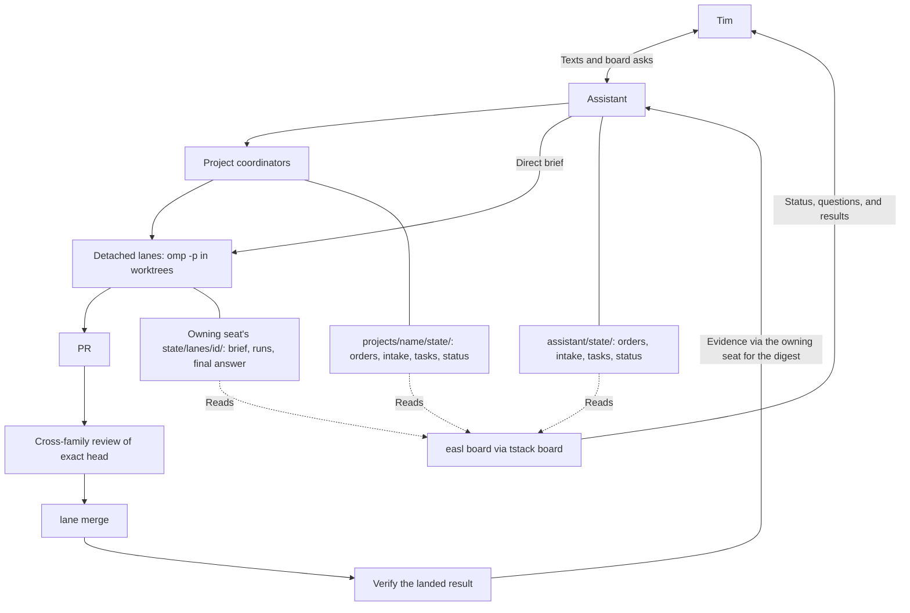

# tstack

tstack is the engine for one conversational assistant, per-project coordinators, and detached worker lanes on easl boards. All working state lives in files. Tim talks to one agent, the assistant, while coordinators organize project work and lanes change code in separate worktrees. The board shows progress and results from that state alongside decision objects, so he never has to ask an agent "what's the status of X?" It runs [pstack's playbooks](pstack/skills/poteto-mode/SKILL.md) in [omp](https://github.com/can1357/oh-my-pi), with easl as the shared board for terminals, questions, and work to inspect.

## One conversation, many workers

The number of conversations should not grow with the number of PRs. The [assistant](roles/assistant.md) takes requests and decides what needs Tim. A [coordinator](roles/coordinator.md) owns a project's briefs, workers, and merge order. A [lane](roles/lane.md) gets a written brief, changes code, and returns evidence with its final answer. The assistant can also start a lane directly.

[`lane start`](bin/lane) creates a worktree and launches a detached `omp -p` process. Each worker has its own branch and a required `--max-time` budget. Workers do not need Tim to keep a chat open. The assistant and coordinators read their results from disk.

## State lives in files

The conversation is a cache, not the record of the work. Each assistant or coordinator directory is a seat, with its own `state/` directory. The [seat roles](roles/assistant.md#state) define the records:

| File in `state/` | What it records |
| --- | --- |
| `orders.md` | Standing orders, including corrections. |
| `intake.md` | Requests and handoffs, with their outcomes. |
| `tasks.tsv` | Tasks and PR references. |
| `status.json` | Current status, a status line, and next steps. |
| `lanes/<id>/` | The brief, lane record, run history, and final answer, managed by `lane`. |

[`tstack board`](bin/tstack) reads local seat state and easl health to draw the board. It does not ask the model to reconstruct progress from chat or fetch status from GitHub. The [`seat-waits` extension](extensions/seat-waits.js) watches lanes, PRs, questions, and incoming texts while the seat runs. A restarted seat restores its waits from state.

## Corrections become structure

pstack's [Encode Lessons in Structure](pstack/skills/principle-encode-lessons-in-structure/SKILL.md) principle and [`/correct`](pstack/skills/correct/SKILL.md) turn repeated mistakes into changes that prevent the mistake. A longer prompt is a weak fix when a tool can reject the bad action.

Three examples already in tstack:

- [`lane merge`](bin/lane) refuses to merge without a structured `READY` review from a different model family on the exact current PR head. A review of an older commit does not count.
- `lane start` and `lane resume` require an explicit `--max-time` for every run. A resumed worker cannot silently inherit an old budget.
- [`seat-waits`](extensions/seat-waits.js) restores waits from files and re-arms a completed wait before it tells the agent about the result. Remembering to wait again is extension code, not another instruction to the model.

Tools enforce mechanical rules. The playbooks and roles keep the judgment about what to build, when to ask, and what evidence is enough.

## Decisions are objects

A decision has a question, options, and a recommendation. `easl ask "<question>" --option <id>=<label> --recommend <id>` puts that object on the board, where Tim can answer it. The answer belongs to the question, rather than a line buried in a chat. The [omp mapping](pstack/skills/poteto-mode/omp.md) explains how seats receive the answer.

Only the assistant texts Tim. The instance's texting CLI, `~/agents/bin/text`, distinguishes `ASK` from `FYI` through `send --ask` and `send --fyi`. An `ASK` ends with a `Reply:` line that lists the exact options. An `FYI` needs no reply. This CLI lives in the instance, not this engine. The [assistant role](roles/assistant.md#work) defines when to use it.

## How the pieces fit

## Three folders

| Folder | Responsibility |
| --- | --- |
| `~/tstack` | The engine in this repo. CLIs, shared roles, extensions, and vendored pstack playbooks. |
| `~/agents` | The instance. Assistant and project seats, working state, machine configuration, and the texting CLI. |
| `~/worktrees` | Project clones and the separate worktrees where lanes change code. |

The separation keeps personal state out of the engine and workers out of the assistant's directory. This repo is only the engine. Running it also needs an instance, omp, easl, authenticated GitHub access, and the host tools in the [setup reference](docs/reference.md#setup).

## A day in the life

1. Tim texts an idea to the assistant.
2. The assistant records it in intake. It writes a brief and starts a lane, or hands the request to a coordinator to do so.
3. The lane changes code, proves the result, and opens a PR.
4. A different model family reviews the exact head and records a structured verdict.
5. Once checks and review pass, `lane merge` merges that reviewed head.
6. The lane verifies the landed result and leaves its evidence in its final answer.
7. The next morning's digest brings Tim decisions, merged and deployed work, and anything still waiting.

## Try the ideas without tstack

- Keep a `STATE.md` per effort with the goal, decisions, current status, and next action. Update it before ending a session.
- Use one planning chat and headless Claude Code or Codex workers. Give each worker a written brief and require a final answer on disk.
- Give every worker run a hard time limit. Read its result before choosing another budget.
- When you correct the same mistake a second time, replace the repeated instruction with a check that rejects it.
- Get an independent review of the exact commit you intend to merge. New commits need a new review.
- Define done by a production signal, such as the deployed version and a successful user action, rather than a green test run alone.
- Write one morning digest with decisions needed, results, and blocked work. Do not make yourself poll every worker chat.

## Credits

[pstack](https://github.com/cursor/plugins/tree/main/pstack) is a collection of engineering playbooks by Lauren Tan, known as poteto, in `cursor/plugins`. The vendored fork retains its [MIT license](pstack/LICENSE).

[Ponytail](https://github.com/DietrichGebert/ponytail), by DietrichGebert, supplies the smallest-complete-change ladder and connected-code review skill. Setup links selected skills from a full checkout that retains its [MIT license](https://github.com/DietrichGebert/ponytail/blob/09c434ab73ca43761c5d8b0c5d341926c2fba710/LICENSE).

[Aspera](https://github.com/Swader/aspera), by Bruno Skvorc, informed the independent-first review instruction. tstack uses omp's cross-family roles rather than Aspera's Codex CLI workflow. No Swader skill text or scripts are copied or installed. The [skill assessment](docs/reference.md#swader-skill-assessment) records the adoption decisions and license limits.

[omp](https://github.com/can1357/oh-my-pi), from can1357, runs the agents. easl provides the boards, terminals, and decision objects. tstack connects them to the instance's files and GitHub PR workflow.

Start with the [local instance guide](docs/getting-started.md). See the [operational reference](docs/reference.md) for setup, managed skill sources, seat waits, updates, commits, boards, lanes, merge gates, PR watching, cleanup, and pstack updates.
